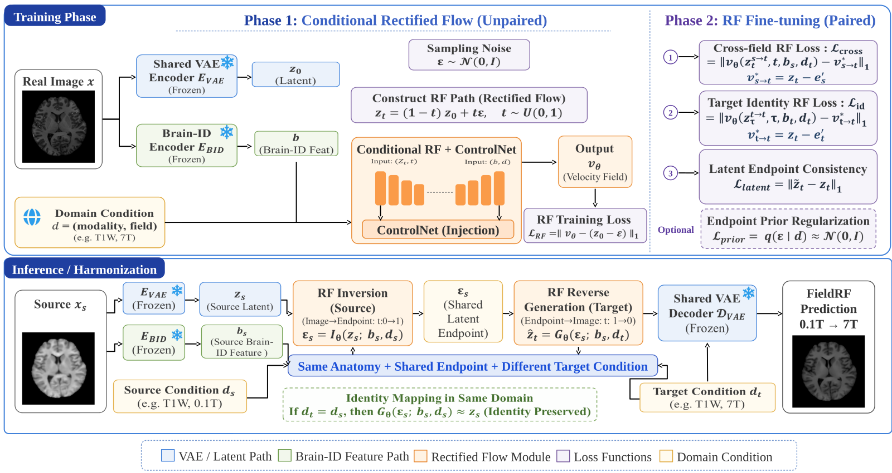

# FieldRF

**Paper:** [FieldRF: Anatomy-Conditioned 3D Rectified Flow for Unified Cross-Field MRI Harmonization](https://papers.miccai.org/miccai-2026-sat/paper/MRIxFields2026_026.pdf)

Anatomy-conditioned 3D rectified flow for cross-field MRI harmonization, with one
shared model for **T1W, T2W, T2FLAIR** and **0.1T, 1.5T, 3T, 5T, 7T**.



[Method and code layout](FieldRF/README.md) · [Baselines](Baseline/README.md) ·
[Evaluation](Evaluation/README.md) · [Submission](Submission/README.md) ·
[Packaging CLI](mrix2026-cli/README.md)

## Reproduction pipeline

### 1. Obtain source, dependencies and pretrained weights

Run setup from the repository root. Configure PyTorch/torchvision for your
hardware first; `requirements.txt` does not pin PyTorch or CUDA.

```bash
git clone --recurse-submodules https://github.com/So-cean/FieldRF.git
cd FieldRF
# Also run this for an existing clone:
git submodule update --init --recursive
python -m pip install --upgrade 'pip>=25.3'
python -m pip install -r requirements.txt --build-constraint build-constraints.txt
python -m pip install --no-deps -e FieldRF/
```

Brain-ID source is pinned at
[`5d8a2d3`](https://github.com/jhuldr/Brain-ID/tree/5d8a2d3eef507180b0cbff4cfe418cdfc5c55253)
in `third_party/Brain-ID` and located automatically (`BRAINID_ROOT` overrides it).
Use this repository's requirements for feature extraction; upstream Brain-ID
requirements pin its older training stack. See [setup](docs/README.md) for
package and CLI installation. `build-constraints.txt` keeps the legacy `visdom`
source build compatible without pinning runtime PyTorch/CUDA.

Obtain the [MRIxFields2026 data](https://github.com/MRIxFields/MRIxFields2026)
and download these weights separately:

| Weights | Source | YAML setting |
|---|---|---|
| `brain_id_pretrained.pth` | [Brain-ID pretrained weights](https://github.com/jhuldr/Brain-ID/blob/5d8a2d3eef507180b0cbff4cfe418cdfc5c55253/README.md#playing-with-brain-id-synthesizer-and-feature-extractor) | `brainid.ckpt_path` in `pretrain.yaml` |
| `autoencoder_v1.pt` | [MAISI VAE, release `4156648`](https://huggingface.co/nvidia/NV-Generate-CT/blob/4156648ce44f5561b75d96b12600fe5afe6b6e8f/models/autoencoder_v1.pt) | `vae.checkpoint` in pretraining, alignment and VAE adaptation |
| `diff_unet_3d_rflow-mr-brain_v0.pt` | [MAISI brain RF, release `67ba36a`](https://huggingface.co/nvidia/NV-Generate-MR-Brain/blob/67ba36a4d3aae5854d7f2f56638e26a641684433/models/diff_unet_3d_rflow-mr-brain_v0.pt) | `bridge.ckpt_path` in `pretrain.yaml` |

Keep these weight revisions when following the recipe. The loader detects the
pretrained UNet architecture and rejects partial loading; the MRI-domain
embedding is intentionally replaced. Data, caches and model weights are not
bundled. The linked MAISI releases provide these SHA-256 checksums:

```text
1f8a7a056d0ebc00486edc43c26768bf1c12eaa6df9dd172e34598003be95eb3  autoencoder_v1.pt
b49aa3162ff94b1852f81e520ed4165c5656000ba176c033063c35350b3305e9  diff_unet_3d_rflow-mr-brain_v0.pt
```

### 2. Configure data and artifact paths

Edit the four files in `FieldRF/configs/`: `pretrain.yaml`,
`endpoint_alignment.yaml`, `vae_finetune.yaml` and `finetune.yaml`.
Replace every `/path/to/` placeholder, set the weight paths above, and use the
same absolute `data.data_root` and `data.cache_root` throughout. Keep the supplied
architecture, modalities, fields and `feat_cache_name: brainid_feat`.

Use the benchmark's official split directories. The data root must contain:

```text
Training_retrospective/{T1W,T2W,T2FLAIR}/{0.1T,1.5T,3T,5T,7T}/*.nii.gz
Training_prospective/{T1W,T2W,T2FLAIR}/{0.1T,1.5T,3T,5T,7T}/*.nii.gz
Validating_prospective/{T1W,T2W,T2FLAIR}/{0.1T,1.5T,3T,5T,7T}/*.nii.gz
```

The downstream checkpoint settings are listed in step 4. Paired training's
`data.subjects` must match the prospective training IDs. For all remaining
cache, training and inference commands, enter the method directory:

```bash
cd FieldRF
```

### 3. Generate both caches for every required split

**The supplied recipe requires MAISI latents and Brain-ID features for every
volume.** Brain-ID source/weights are needed for caching; subsequent RF training
and inference read the caches without running Brain-ID again.

| Split | Used by |
|---|---|
| `Training_retrospective` | RF pretraining, endpoint alignment, VAE adaptation |
| `Training_prospective` | Paired RF adaptation and training diagnostics |
| `Validating_prospective` | VAE validation and inference |

On a suitably sized CUDA GPU, generate both caches for all three modalities and
five fields in each split:

```bash
for split in Training_retrospective Training_prospective Validating_prospective; do
  python scripts/cache_latents.py \
    --config configs/pretrain.yaml --split "$split" || exit 1
  TORCH_FORCE_NO_WEIGHTS_ONLY_LOAD=1 python scripts/cache_brainid_feat.py \
    --config configs/pretrain.yaml --split "$split" --feats 4 || exit 1
done
```

The command-scoped environment setting supports Brain-ID's official legacy
checkpoint loader on PyTorch 2.6+. A preprocessed `384³` image yields a
`(4,96,96,96)` latent. Brain-ID processes it at `192³` in `[0,1]`; the supplied
`[64,64]` ControlNet requires native `(64,192,192,192)` `feat4` (`feat4_pool=1`).

Each input stem must have both files:

```text
<cache_root>/<split>/latent/<modality>/<field>/<stem>.pt
<cache_root>/<split>/brainid_feat/<modality>/<field>/<stem>.b2nd
```

Check writer summaries, including Brain-ID's `errors` count. Existing outputs
are skipped; changing feature geometry requires regeneration. Use `--help` for
single-modality extraction, field subsets and overwrite controls.

### 4. Train and connect the stage artifacts

After caching, run these stages in order:

```bash
python scripts/train.py --config configs/pretrain.yaml
python scripts/train_endpoint_aligner.py --config configs/endpoint_alignment.yaml
python scripts/finetune_vae.py --config configs/vae_finetune.yaml
python scripts/finetune.py --config configs/finetune.yaml
```

| Stage | Artifact selection / downstream setting |
|---|---|
| RF pretraining (100 epochs) | Set `finetune_from: runs/pretrain/fieldrf_epoch90.pt` in both alignment and paired configs |
| Endpoint alignment (20 epochs) | Set paired `endpoint_aligner_checkpoint: runs/endpoint_alignment/fieldrf_unpaired_alignment_best.pt` |
| VAE decoder adaptation (5 epochs) | Set paired `vae.checkpoint: runs/vae_finetune/vae_finetune_epoch1.pt`; use this decoder for inference |
| Paired RF adaptation (20 epochs) | `runs/paired_finetune/fieldrf_paired_latest.pt`, containing joint RF/aligner EMA |

The aligner's recorded RF base must match paired `finetune_from`, including
when relocating checkpoints. VAE adaptation freezes the encoder, so existing
latent caches remain valid. Paired adaptation uses same-subject, same-modality
prospective training pairs, with the VAE frozen. RF, ControlNet and the aligner
share parameters across fields and modalities.

Distributed RF pretraining, endpoint alignment and VAE adaptation use native
PyTorch DDP. YAML batch sizes are per device. For example:

```bash
torchrun --standalone --nproc_per_node=2 scripts/train.py --config configs/pretrain.yaml --dist
torchrun --standalone --nproc_per_node=2 scripts/finetune_vae.py --config configs/vae_finetune.yaml --dist
```

Resume RF pretraining with `--resume <fieldrf_epochN.pt>` and VAE adaptation
with `--resume_ckpt <vae_finetune_epochN.pt>`. New VAE training checkpoints
restore weights, optimizer, LR plan, epoch, accumulation progress at the epoch
boundary, loss balancing and per-rank random/data-loader state. Keep the same
training recipe and rank count. For older VAE files containing only weights,
use `--init_ckpt` to start a new adaptation run. Paired RF adaptation currently
runs on a single CUDA device.

## Inference

Use the paired checkpoint for **both** RF and endpoint-aligner EMA, together
with the adapted epoch-1 decoder:

```bash
python scripts/inference.py \
  --config configs/finetune.yaml \
  --checkpoint runs/paired_finetune/fieldrf_paired_latest.pt \
  --vae_checkpoint runs/vae_finetune/vae_finetune_epoch1.pt \
  --endpoint_checkpoint runs/paired_finetune/fieldrf_paired_latest.pt \
  --inversion_steps 20 --inversion_solver euler \
  --n_infer_steps 20 --task task3 --split Validating_prospective \
  --mode pro_pretrained --epoch_tag epoch20 \
  --output_dir /path/to/predictions
```

Task 3 uses one model for all non-identity field pairs. Both caches and the raw
source/reference grid are required; Brain-ID source/weights are no longer
needed. TTA defaults to none. See the [CLI guide](mrix2026-cli/README.md) for
output packaging and `--help` for source/target subsets.

`fieldrf_paired_latest.pt` after epoch 20 and the validation-selected
`fieldrf_paired_best_task3.pt` use different selection rules. To use the latter,
pass it as both checkpoint arguments and set its actual epoch tag. To test
transport without the aligner, omit `--endpoint_checkpoint` and add
`--source_endpoint_transport`. Keep the decoder and inversion settings consistent.

## Verification

Run the CPU suite from the repository root:

```bash
python -m pytest -q FieldRF/tests mrix2026-cli/tests
```

**48 tests with 9 subtests passed locally.** The suite includes two-rank CPU/Gloo
gradient averaging, parameter synchronization and exact epoch-boundary resume.
[CI](https://github.com/So-cean/FieldRF/actions/workflows/ci.yml) checks package
installation, command entry points and tests on Python 3.10/3.12. A separate real-data check on one A100 80GB
used the full network: 45 latent and 45 Brain-ID caches, short runs of all four
training stages, a complete 60-pair fine-tuning epoch, and 25 inference outputs.
Caches/weights were finite, the VAE encoder was unchanged and its decoder
updated, and outputs preserved source shape/affine.

For a small check, use separate data/cache/output paths, one matched prospective
subject and one volume per split/modality/field. Run each stage for one epoch
(`--n_epochs 1`; VAE uses `--epochs 1`), change both RF bases to `fieldrf_epoch1.pt`
and use the resulting aligner/decoder paths. See the
[smoke instructions and test record](REPRODUCIBILITY.md#run-an-isolated-small-data-check)
for details. Full-duration benchmark metrics and NPU execution were not verified.
CUDA/NCCL distributed execution remains to be validated on hardware; the
DDP regressions use CPU/Gloo. See [remaining limits](REPRODUCIBILITY.md#remaining-limits).

For comparison methods, configure `.env` from `.env.example` and follow the
[baseline guide](Baseline/README.md).

## License

See [LICENSE](LICENSE).

## Citation

If you use FieldRF, please cite the paper from the MRIxFields2026 satellite event
at MICCAI 2026. The proceedings metadata follows the
[official MICCAI record](https://papers.miccai.org/miccai-2026-sat/MRIxFields2026_026.html):

```bibtex
@inproceedings{SonHai_FieldRF_MICCAISAT2026,
  author = {Song, Haiyu and Xiang, Lei and Yang, Zongjian and Wu, Yang and Shen, Dinggang and Wang, Qian},
  title = {{FieldRF: Anatomy-Conditioned 3D Rectified Flow for Unified Cross-Field MRI Harmonization}},
  booktitle = {Medical Image Computing and Computer Assisted Intervention -- MICCAI 2026 Workshops and Challenges},
  series = {Lecture Notes in Computer Science},
  volume = {17274},
  publisher = {Springer Nature Switzerland},
  year = {2026},
  url = {https://papers.miccai.org/miccai-2026-sat/MRIxFields2026_026.html}
}
```

DOI and page numbers are not yet available on the official page.

The benchmark and evaluation framework come from
[MRIxFields/MRIxFields2026](https://github.com/MRIxFields/MRIxFields2026).
FieldRF builds on [MONAI](https://github.com/Project-MONAI/MONAI),
[Brain-ID](https://github.com/jhuldr/Brain-ID) and
[MAISI / MAISI-v2](https://github.com/NVIDIA-Medtech/NV-Generate-CTMR).
Please also cite the corresponding original works in [REFERENCES.md](REFERENCES.md).
