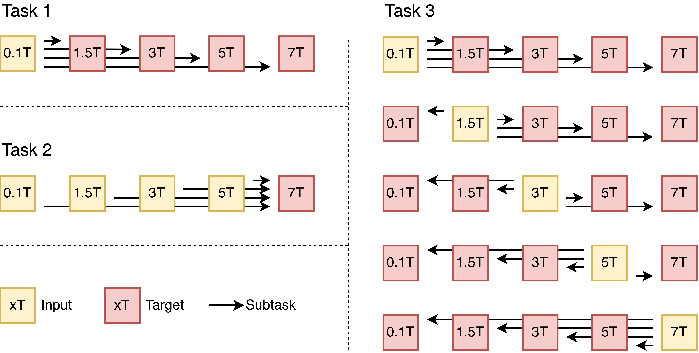

# Validation submission format

Use [mrix2026 CLI](../mrix2026-cli/README.md) for segmentation, building,
checking and ZIP packaging. It consumes the sweep layout written by FieldRF
and the baseline inference scripts.

## Tasks

| Task | Translations | Modalities | Segmentation |
|---|---|---|---|
| Task 1 | 0.1T / 1.5T / 3T / 5T → 7T | T1W, T2W, T2FLAIR | Required for Dice/Volume |
| Task 2 | 0.1T → 1.5T / 3T / 5T / 7T | T1W, T2W, T2FLAIR | Required for Dice/Volume |
| Task 3 | All 20 directed cross-field pairs | T1W, T2W, T2FLAIR | Voxel metrics only |



## Input and output layout

Inference sweeps identify the translation in the directory name. FieldRF writes
target-field filenames:

```text
predictions/
  task1_0.1T_to_7T_T1W/<method>/<mode>/<epoch>/
    P_T1W_7T_0007.nii.gz
```

Baseline outputs may retain source-field tags. The builder reads subject IDs
from either form and writes the target-field tag:

```text
submission/task1/
  T1W/0.1T_to_7T/pred/P_T1W_7T_0007.nii.gz
  T1W/0.1T_to_7T/seg/P_T1W_7T_0007_seg.nii.gz
```

Task 2 follows the same structure. Task 3 contains `pred/` only. The builder
uses the axial slab `[150, 180)` in the original dataset grid; predictions and
segmentations must share shape and affine before packaging. Filenames and
expected subjects are checked by the retained scorer.

## Packaging

Install the CLI as described in [setup](../docs/README.md), configure dataset,
prediction, segmentation and submission paths, then run:

```bash
mrix2026 segment --input-dir /path/to/predictions --output-dir /path/to/segmentations
mrix2026 build --predictions-dir /path/to/predictions \
  --predictions-seg-dir /path/to/segmentations \
  --output-dir /path/to/submission --tasks task1 --dry-run
```

Select `--task1-method`, `--task1-mode` and `--task1-epoch` to match the inference
sweep. After checking the dry run, build without `--dry-run`, then package:

```bash
mrix2026 zip --submission-dir /path/to/submission \
  --output-dir /path/to/zips --tasks task1
```

Each ZIP starts at the modality directories, with no outer `task1/` prefix.
Use `mrix2026 check --help` for local validation against ground truth. The CLI
uses [the retained scorer](evaluation-2026/README.md); metric references are
also provided under [Evaluation](../Evaluation/README.md).
